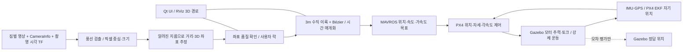

# 카메라 풍선 위치 추정 · STL 드론 비행 시뮬레이션

짐벌 카메라로 **정지한 지름 30 cm 풍선의 좌표를 추정**하고, 사용자 STL 10개를 조립한 **총중량 2 kg 기체**가 **3 m 수직 이륙 → 3차 Bézier 곡선 → 목표 좌표 도달·대기**를 수행하는 ROS 2 Humble / Gazebo Classic / PX4 SITL / MAVROS 실험입니다. **LiDAR는 사용하지 않습니다.**

현재 작업은 [`balloon_sim/`](balloon_sim)에 모았습니다. 월드·짐벌·Qt UI·RViz 설정·기체 STL·경로/비행 코드가 포함됩니다. 기존 `flight/`, `camera/`, `simulation/`은 별도 착륙 프로젝트이며 이 실행에 사용하지 않습니다.

- [동역학·좌표변환·경로 수식 상세](balloon_sim/docs/dynamics.md)
- [설치·빌드·실행 명령](balloon_sim/docs/run.md)
- [검증 결과와 미검증 항목](balloon_sim/docs/validation.md)
- [구성 요소와 출처](balloon_sim/docs/sources.md)

## 실행 명령

Ubuntu 22.04, ROS 2 Humble, Gazebo Classic 11 기준입니다. 최초 의존성 설치는 [실행 문서](balloon_sim/docs/run.md)를 확인하세요. **이 명령은 시뮬레이션만 실행합니다.**

```bash
git clone --branch cho --single-branch https://github.com/SeyeongW/PX4-ROS2.git
cd PX4-ROS2/balloon_sim
./tools/build_px4.sh
./tools/build_workspace.sh
./tools/run_gazebo.sh
```

GUI가 필요 없는 점검:

```bash
./tools/run_gazebo.sh gui:=false ui:=false rviz:=false
```

UI 순서: **탐지 시작 → 유효 좌표 확인 → 락 → 자동 경로 미리보기 → 발사 → 수직 이륙 → 곡선 추종 → 도달·대기**. 발사에는 좌표·경로·FCU 준비가 모두 필요합니다. 중단은 현재 위치에서 착륙하며 자동 귀환을 뜻하지 않습니다. 종료는 실행 터미널에서 `Ctrl+C`입니다. 실행 로그·데이터는 기본적으로 임시 폴더에 생성되고 종료 후 삭제됩니다.

## 시스템 구성



기본 표적은 시스템 오른쪽 **수평 40 m, 높이 10 m**, 월드 좌표 `(0, -40, 10)`입니다. 기체 모델 기준점 초기 위치는 `(-2, 0, 0.2045)` m입니다. 실제 계획 시작점은 준비된 FCU 자기 위치에서 정합니다. 카메라는 미검출 시 yaw 탐색을 하고 검출 후 화면 중심에 정렬합니다.

## 적용된 동역학 수식

### 1. 강체 운동과 모터

월드 W는 ENU, 기체 B는 FLU, R은 기체→월드 회전입니다. Ω는 기체 각속도, ωᵢ는 모터 각속도입니다.

$$
\dot{\mathbf p}_W=\mathbf v_W,\qquad
m\dot{\mathbf v}_W=m\mathbf g_W+R_{WB}\sum_{i=1}^{4}T_i\mathbf a_i+\mathbf F_{contact}
$$

$$
J\dot{\boldsymbol\Omega}+\boldsymbol\Omega\times(J\boldsymbol\Omega)
=\sum_{i=1}^{4}\left[(\mathbf r_i-\mathbf c)\times T_i\mathbf a_i+s_iQ_i\mathbf a_i\right]+\boldsymbol\tau_{contact},
\qquad \dot R_{WB}=R_{WB}[\boldsymbol\Omega]_\times
$$

$$
T_i=k_T\omega_i^2,\qquad Q_i=k_Q\omega_i^2,\qquad
\dot\omega_i=\frac{\omega_{cmd,i}-\omega_i}{\tau_{up/down}}
$$

로터 축은 기체 +Z이며 rᵢ는 모터 위치, c는 CG입니다. 반작용 토크 부호 sᵢ는 CCW에서 −1, CW에서 +1입니다. 실제 시간 적분과 접촉은 Gazebo가 처리합니다. 기체 위치를 강제로 바꾸는 방식으로 비행하지 않습니다. 현재 동체 양력·항력 모델은 적용하지 않습니다.

| 항목 | 현재 값 | 근거 |
|---|---:|---|
| 총질량 | 2 kg, 기체·배터리 포함 | 사용자 지정 |
| CG | 기체 중심 | 사용자 가정 |
| 관성 J | diag(0.02, 0.02, 0.01) kg·m² | 실측 전 가정 |
| 모터/시험 조건 | PACER P2207 V3, 1950 KV, 6S, P49436-3 | 제조사 정적 시험표 |
| kT | 약 1.447756 × 10⁻⁶ N/(rad/s)² | 원점 통과 최소제곱 적합 |
| kQ | 0.01 kT | 반작용 토크 가정, 실측 아님 |
| 상승/하강 응답시간 | 0.025 s / 0.05 s | 가정 |
| 모터 최대 회전수 | 33,011 RPM | 시험표 상한 |

[물리 설정 JSON](balloon_sim/balloon_locator/config/stl_pacer_quad.json), [모델 생성 코드](balloon_sim/balloon_locator/balloon_locator/stl_airframe.py), [T-MOTOR 공식 시험표](https://www.tmotorhobby.com/images/20220411/1649663656357709.jpg).

### 2. 카메라 좌표와 NED 변환

알려진 풍선 지름 D, 검출 지름 dpx, 초점거리 fx, fy로 **작은 시야각 근사 거리**를 구합니다. 크기 미상의 물체 절대 거리를 단안 영상만으로 알아내는 방법은 아닙니다.

$$
\rho\approx\frac{D(f_x+f_y)}{2d_{px}},\qquad
\hat{\mathbf r}_C=\frac{K^{-1}(u,v,1)^T}{\|K^{-1}(u,v,1)^T\|},\qquad
\mathbf p_{N,station}=\mathbf t_{NC}+\rho R_{NC}\hat{\mathbf r}_C
$$

K는 보정 행렬이고 카메라 변환에는 촬영 시각의 짐벌 자세·장착 변환이 포함됩니다. 지상국 NED와 FCU NED는 원점이 다르므로 월드 좌표를 거쳐 정합합니다. 세계좌표에서의 북방향을 ψN, FCU 원점을 oW라 하면:

$$
R_{NW}=\begin{bmatrix}\cos\psi_N&\sin\psi_N&0\\\sin\psi_N&-\cos\psi_N&0\\0&0&-1\end{bmatrix},\qquad
\mathbf p_{N,FCU}=R_{NW}(\mathbf p_W-\mathbf o_W)
$$

현재 북방향은 ψN = π/2입니다. 정지 EKF 위치와 선언된 시뮬레이션 spawn을 이용해 원점을 정합합니다. **MAVROS의 ROS 입력은 ENU**이므로 어댑터가 NED→ENU로 변환하고, MAVROS가 MAVLink NED로 변환합니다. 자세한 기준은 [수식 문서](balloon_sim/docs/dynamics.md)를 따릅니다. Gazebo 정답 표적 좌표는 오차 평가에만 사용합니다.

### 3. 3 m 수직 이륙과 3차 Bézier 경로

초기 위치 H, 곡선 시작점 P₀ = H + 3ez, 목표 P₃ = G로 둡니다. 현재 수직 핸들은 h = min(4, (Gz−P₀z)/2)이며 P₁ = P₀ + h ez, P₂ = P₀ + 2h ez입니다. 목표 높이 등 유효성 조건은 코드에서 검사합니다.

$$
B(u)=(1-u)^3P_0+3(1-u)^2uP_1+3(1-u)u^2P_2+u^3P_3,\qquad 0\le u\le1
$$

$$
\mathbf v=B'(u)\dot u,\qquad
\mathbf a=B''(u)\dot u^2+B'(u)\ddot u
$$

$$
\mathbf j=B'''(u)\dot u^3+3B''(u)\dot u\ddot u+B'(u)\dddot u
$$

3차는 **공간 곡선의 차수**이고 시간 함수 u(t)는 별도의 **5차 다항식**입니다. 수직 구간과 곡선 구간을 계획상 위치·속도·가속도 연속으로 연결하며, 연결 상승 속도는 0.35 m/s입니다. 최대 속도 1.5 m/s, 가속도 0.6 m/s², jerk 1.2 m/s³를 계획 기준으로 사용합니다. 실제 높이 도달 여부에 따른 미션 시각 제한과 기체 응답까지 완벽한 연속성을 보장하는 것은 아닙니다.

### 4. 경로를 추종하는 제어 구조

Python 미션은 위치·속도·가속도 목표를 MAVROS로 전달합니다. PX4가 EKF 자기 위치를 이용해 **위치 P → 속도 PID → 추력 방향·자세 목표 → 자세 P → 각속도 PID → 모터 배분**을 수행합니다. 이는 제어 구조 요약이며 제한·보상·적분 항은 PX4 구현을 따릅니다.

**현재 STL 멀티콥터 분기는 yaw 목표를 명시하지 않습니다.** 기체가 기울어져 전진하는 물리 운동과, 기수가 항상 경로 접선 방향으로 향하는 제어는 구분해야 합니다. 고정익 전환·수평 기수 비행은 현재 기본 모델에 구현되지 않았습니다.

## 확인된 결과와 남은 제한

이전 로컬 전체 실행 `20261030_stl_pacer_05`에서 수직 상승 **3.009 m**, 최대 EKF 경로 오차 **0.288 m**, 도달 대기 후 실제 Gazebo 위치→락 목표 오차 **0.291 m**를 확인했습니다. 실제 최대 가속도 **0.809 m/s²**는 기준 0.6 m/s²를 초과했습니다. 실기체 성능이나 모든 운동 제한을 검증한 결과가 아닙니다.

기본 실험은 **목표 좌표 도달 후 정지·대기**입니다. 사각 게이트 통과 판정 코드는 남아 있지만 기본 비활성입니다. 2 kg 조건의 모터 장착 간섭, CG·관성 실측, 배터리 전압 강하, 실물 카메라 40 m 정확도는 미검증입니다. 공개 패키지의 새 빌드/실행 확인과 이전 비행 결과는 [검증 문서](balloon_sim/docs/validation.md)에서 구분합니다.
