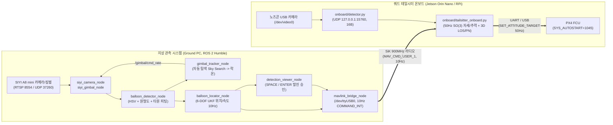

# 🛠️ 실기체(Hardware) 전환 및 운용 가이드 (`balloon_sim`)

본 문서는 기존 구현의 구조와 설정 예시를 기록합니다. **실기체 운용 준비가 완료됐다는 검증 문서가 아닙니다.** 실제 FC 모델·펌웨어 버전·카메라 교정은 미확인이고, 온보드는 라즈베리 파이로만 식별된 상태입니다. 아래 실행 예시와 파라미터를 실기체 운용 승인으로 해석하지 마세요.

목적은 레이싱 드론의 지정 지점 통과 실험입니다. 승인 취소·만료, 영상·짐벌 자세의 신선도 검사, 정지 송신 실패 재시도를 보완했습니다. 승인 표시와 프로세스 종료만으로 비행·정지 완료를 확인할 수 없습니다. 사전검사 실패를 무시하는 런처의 `hardware_check ... || true`는 이번 범위에서 변경하지 않았습니다. 잘못된 설치본을 실행하지 않도록 현재 `balloon_sim/install`의 패키지만 선택합니다.

---

## 1. 전체 하드웨어 시스템 아키텍처



---

## 2. 지상 관측 시스템(Ground Station) 설정 체크리스트

지상국 설정 파일은 [`balloon_locator/config/balloon_locator.yaml`](balloon_locator/config/balloon_locator.yaml)에 정의되어 있습니다. 현장에서 비행 전 아래 항목을 반드시 실측하여 기입해야 합니다.

| 파라미터 섹션 | 파라미터 키 | 설명 및 현장 입력 방법 |
| :--- | :--- | :--- |
| `siyi_camera_node` | `rtsp_url` | SIYI A8 mini RTSP 주소 (기본 `rtsp://192.168.144.25:8554/main.264`) |
| `siyi_camera_node` | `calibration_file` | 체커보드 캘리브레이션 YAML 파일 경로 (`1920×1080` 해상도 일치 필수) |
| `balloon_locator_node` | `calibration_valid` | 위 보정 및 축 부호 확인 완료 후 `true`로 변경 |
| `balloon_locator_node` | `balloon_diameter_m` | 실제 불어놓은 풍선의 지름 `[m]` (예: `0.30`) |
| `balloon_locator_node` | `base_heading_deg` | 짐벌 `yaw = 0°`가 가리키는 진북(또는 자북) 기준 방위각 `[deg]` |
| `gimbal_tracker_node` | `enable_search` | `true`일 때 영상 처리 결과와 짐벌 자세가 모두 신선해야 탐색·추적 허용. 빈 검출 배열은 정상 영상 처리, 배열 미수신은 장애로 구분 |
| `gimbal_tracker_node` | `attitude_timeout_sec` | 자세 timestamp·수신 경과시간 상한, 기본 `0.5 s`. 검출 스트림은 `lost_timeout_sec` 상한 적용 |
| `mavlink_bridge_node` | `cam_lat_deg`, `cam_lon_deg` | 지상 짐벌 카메라 설치 위치의 위도·경도 `[deg]` (현장 GPS 실측) |
| `mavlink_bridge_node` | `cam_height_above_home_m` | (카메라 회전중심 높이) $-$ (드론 이륙 패드 지면 높이) `[m]` |
| `mavlink_bridge_node` | `require_launch_approval` | 기본 `true`. 유효한 추정 좌표에 대한 송신 승인. FC 무장·비행 준비 확인을 뜻하지 않음 |
| `mavlink_bridge_node` | `approval_timeout_sec` | 기본 `30 s`. 반복 승인으로 연장하지 않으며 취소·만료·좌표 상실·송신 실패 후 재승인 필요 |

### 오프라인 설정 무결성 검사 (장비 연결 전 확인)
```bash
cd /path/to/PX4-ROS2/balloon_sim
./tools/build_workspace.sh
source install/local_setup.bash
ros2 run balloon_locator hardware_check --config balloon_locator/config/balloon_locator.yaml --bridge
```

---

## 3. 지상 관측 시스템(Ground PC) 실행 방법

### 3.1 센서·뷰어 단독 리허설 (드론 송신 없이 탐색/락온/UKF 좌표 검증)
```bash
cd /path/to/PX4-ROS2/balloon_sim
./tools/run_hardware_gcs.sh
```
- 정상적인 검출 스트림과 신선한 짐벌 자세를 수신하면 탐색합니다. 영상/자세 미수신·만료·비정상 값에서는 0 속도를 명령합니다. 드라이버는 정지 송신 실패를 재시도하며, UDP 송신 성공이 실제 짐벌 정지를 확인한 것은 아닙니다.
- 뷰어에는 기존 검출·추정 결과가 표시됩니다. 좌표 표시만으로 짐벌의 실제 정렬이나 FC의 비행 준비 상태가 확인되는 것은 아닙니다.

### 3.2 실비행 연동 실행 (SiK 모뎀 `/dev/ttyUSB0` 10Hz 송신 포함)
```bash
cd /path/to/PX4-ROS2/balloon_sim
./tools/run_hardware_gcs.sh --with-bridge
```
- 신선하고 유효한 좌표가 확인되면 `SPACE`/`ENTER`로 `/balloon/launch_approved`에 승인 요청합니다. `C`/`ESC`는 승인을 취소합니다. 만료·거절 뒤에는 `C`를 누른 후 다시 승인합니다. 브리지 재시작 시 이전 승인은 유지되지 않습니다.
- `/balloon/bridge_status`는 승인 상태, 좌표 유효성, 실제 로컬 송신 성공 여부를 구분합니다. 별도 토픽의 좌표·상태가 아직 짝을 이루지 못하면 `waiting_pair`로 그 회차만 송신을 건너뛰고, 실제 데이터 만료 시에는 승인을 취소합니다. UI의 `TRANSMITTING`은 온보드 수신/비행 성공 확인이 아닙니다. FC의 system/component가 일치하는 신선한 HEARTBEAT가 있을 때만 `ARMED`/`DISARMED`를 표시하고, 없으면 `UNKNOWN`입니다. 무장 상태도 비행·정지 완료를 입증하지 않습니다.
- **승인 취소는 후속 좌표 송신을 중단합니다. FC에 비행 중단·착륙 명령을 보내지 않습니다.** 이후 기체 동작은 온보드 제어기와 FC 설정에 달려 있으며 이번에 실기체로 검증하지 않았습니다.
- `tools/approve_launch.sh`와 `/tmp/balloon_launch_approved`는 기존 Gazebo 시뮬레이션 전용입니다. 실기체 뷰어/브리지는 이 파일로 승인하지 않습니다. ROS Bool 승인은 로컬 운용 인터페이스이며 인증 프로토콜이 아닙니다.

---

## 4. 드론 온보드 컴퓨터(Jetson Orin Nano / RPi) 실행 방법

드론 탑재 컴퓨터에는 ROS 2가 없어도 동작하도록 순수 Python(`pymavlink`, `numpy`, `opencv-python`) 기반의 경량 온보드 패키지([`balloon_locator/onboard/`](balloon_locator/onboard/))가 준비되어 있습니다.

### 4.1 주요 파일 구성
- [`onboard/detector.py`](balloon_locator/onboard/detector.py): 노즈콘 USB 카메라(`/dev/video0`)에서 적색 풍선을 검출(서브픽셀 타원 피팅)하여 로컬 UDP(`127.0.0.1:15760`)로 `[detected, dx_px, dy_px, radius_px]` 16바이트 패킷을 고속 송신합니다.
- [`onboard/tailsitter_onboard.py`](balloon_locator/onboard/tailsitter_onboard.py): 기존 온보드 제어 구현입니다. 이번 관측·설정 검사에서는 비행 동작을 검증하지 않았습니다.
- [`onboard/run_tailsitter.sh`](balloon_locator/onboard/run_tailsitter.sh): 기존 프로세스 기동·종료 래퍼입니다. 프로세스가 종료됐다는 사실은 비행체의 안전정지 완료를 뜻하지 않습니다.

### 4.2 PX4 Flight Controller (FC) 쿼드 테일시터 설정 (QGroundControl)

현재 소스의 시뮬레이션([`stl_airframe.py`](balloon_locator/balloon_locator/stl_airframe.py#L380-L395), [`stl_pacer_quad.json`](balloon_locator/config/stl_pacer_quad.json))은 **무타면(4로터 차동 추력 전용) 쿼드 테일시터(Quad-Tailsitter)** 가정입니다. 아래 표는 구현 참고이며, 미확인 실기체 FC에 동일 설정을 적용하라는 지시가 아닙니다.
- **전체 상세 파라미터 표**: **[`PX4_PARAMETERS.md`](PX4_PARAMETERS.md)**
- **QGC 일괄 불러오기 파일**: **[`px4_quadtailsitter.params`](balloon_locator/config/px4_quadtailsitter.params)**

| 구분 | PX4 파라미터 | 설정값 | 설명 |
| :--- | :--- | :--- | :--- |
| **기체 프레임** | `SYS_AUTOSTART` | `13003` (실기체) / `1045` (SITL) | QGC $\to$ Airframe $\to$ **VTOL Tailsitter** $\to$ *Generic Quadrotor X Tailsitter* |
| **제어 할당** | `CA_AIRFRAME` | `4` | Tailsitter VTOL 제어 할당 모드 |
| **로터/서보 수** | `CA_ROTOR_COUNT` / `CA_SV_CS_COUNT` | `4` / `0` | 조종면(엘리베이터/에일러론 서보) 없이 4개 모터 차동 추력으로만 피치·롤·요 제어 |
| **로터 추력축** | `CA_ROTOR0..3_AX, AY, AZ` | `0.0, 0.0, -1.0` | 4개 로터 모두 기체 코 방향($-\mathbf{z}_b$)으로 추력 발생 |
| **로터 위치 (FRD)** | `CA_ROTOR0..3_PX, PY, PZ` | `stl_pacer_quad` 규격 | Rotor 0: `(0, +0.12, 0.015)` CCW (`KM=+0.01`)<br>Rotor 1: `(0, -0.12, 0.015)` CCW (`KM=+0.01`)<br>Rotor 2: `(+0.12, 0, 0.015)` CW (`KM=-0.01`)<br>Rotor 3: `(-0.12, 0, 0.015)` CW (`KM=-0.01`) |
| **FC 장착 방향** | `SENS_BOARD_ROT` | 보드 장착 방향에 맞춤 | **기체를 지면에 수직으로 세워 놓았을 때(코가 하늘)** QGC 인공수평계가 `Roll = 0°, Pitch = 0°`가 되도록 수평(Level Horizon) 보정 필수 |
| **대기속도계 해제** | `SYS_HAS_NUM_ASPD` / `FW_USE_AIRSPD` | `0` / `0` | 피토관(Airspeed Sensor) 미장착 기체에서 센서 에러 방지 |
| **호버 추력** | `MPC_THR_HOVER` | `0.28 ~ 0.68` (기체 중량비) | 2kg 6S P2207 기준 약 `0.28~0.35`, 실기체 호버링 테스트값 반영 |
| **MAVLink 포워딩** | `MAV_0_FORWARD` / `MAV_1_FORWARD` | `1` / `1` | SiK 모뎀(TELEM1)으로 들어온 지상국 `COMMAND_INT`를 온보드 컴퓨터(TELEM2/USB)로 전달 |

### 4.3 온보드 제어기 실행 명령

#### Step 1: 오프라인 파라미터 검증 (하드웨어 I/O 없음)
```bash
cd /path/to/PX4-ROS2/balloon_sim/balloon_locator/onboard
./run_tailsitter.sh
```

#### Step 2: 실기체 폐루프 미션 대기 및 실행 (`WAIT_TARGET -> TAKEOFF -> TRANSITION -> UKF -> LOS/PN -> RTL`)
아래는 기존 소스에 포함된 실행 예시이며 자동 무장 요청을 포함합니다. `WAIT_TARGET` 등은 코드의 상태명일 뿐 실제 기체 상태의 증거가 아닙니다. 이륙·귀환·착륙의 실제 수행 및 완료는 이번 점검에서 확인되지 않았으며, 아래 예시를 실기체에 적용하지 마세요.
```bash
./run_tailsitter.sh --execute \
  --url /dev/ttyACM0 --baud 921600 \
  --takeoff-alt 20.0 \
  --fx 640.0 --fy 640.0 \
  --balloon-diameter 0.30 \
  --cruise-speed 14.0 \
  --hover-thrust 0.68
```
> **비상 제어권 전환 미검증:** 기존 코드는 모드 변경을 감지하도록 작성돼 있지만, 실제 FC·RC·통신 상실 상황에서의 수락 여부와 동작은 확인하지 않았습니다. 즉시 제어권 반환이나 안전정지를 보장하는 문구로 사용하지 마세요.
