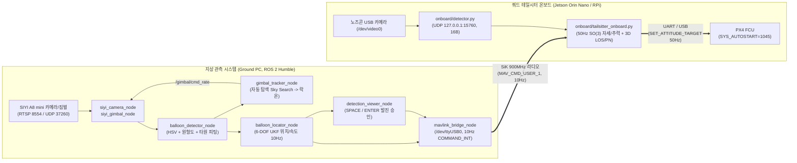

# 🛠️ 실기체(Hardware) 전환 및 운용 가이드 (`balloon_sim`)

본 문서는 Gazebo SITL 시뮬레이션에서 검증된 **지상-공중 협력형 쿼드 테일시터(Quad-Tailsitter) 풍선 추적 및 종말 비전 유도 시스템**을 실물 하드웨어(SIYI A8 mini + SiK 텔레메트리 라디오 + 쿼드 테일시터 온보드 컴퓨터)로 이식하여 운용하기 위한 매뉴얼입니다.

---

## 1. 전체 하드웨어 시스템 아키텍처



---

## 2. 지상 관측 시스템(Ground Station) 설정 체크리스트

지상국 설정 파일은 [`balloon_locator/config/balloon_locator.yaml`](file:///home/seyeongw/ros2_ws/PX4-ROS2/balloon_sim/balloon_locator/config/balloon_locator.yaml)에 정의되어 있습니다. 현장에서 비행 전 아래 항목을 반드시 실측하여 기입해야 합니다.

| 파라미터 섹션 | 파라미터 키 | 설명 및 현장 입력 방법 |
| :--- | :--- | :--- |
| `siyi_camera_node` | `rtsp_url` | SIYI A8 mini RTSP 주소 (기본 `rtsp://192.168.144.25:8554/main.264`) |
| `siyi_camera_node` | `calibration_file` | 체커보드 캘리브레이션 YAML 파일 경로 (`1920×1080` 해상도 일치 필수) |
| `balloon_locator_node` | `calibration_valid` | 위 보정 및 축 부호 확인 완료 후 `true`로 변경 |
| `balloon_locator_node` | `balloon_diameter_m` | 실제 불어놓은 풍선의 지름 `[m]` (예: `0.30`) |
| `balloon_locator_node` | `base_heading_deg` | 짐벌 `yaw = 0°`가 가리키는 진북(또는 자북) 기준 방위각 `[deg]` |
| `gimbal_tracker_node` | `enable_search` | `true` 설정 시 풍선 미검출 상태에서 상공을 자동 스캔하다가 발견 즉시 락온 |
| `mavlink_bridge_node` | `cam_lat_deg`, `cam_lon_deg` | 지상 짐벌 카메라 설치 위치의 위도·경도 `[deg]` (현장 GPS 실측) |
| `mavlink_bridge_node` | `cam_height_above_home_m` | (카메라 회전중심 높이) $-$ (드론 이륙 패드 지면 높이) `[m]` |
| `mavlink_bridge_node` | `require_launch_approval` | `true` 설정 시 사용자가 `SPACE`/`ENTER`로 승인하기 전까지 드론에 발진 좌표를 송신하지 않음 |

### 오프라인 설정 무결성 검사 (장비 연결 전 확인)
```bash
cd /home/seyeongw/ros2_ws/PX4-ROS2/balloon_sim
./tools/build_workspace.sh
source install/setup.bash
ros2 run balloon_locator hardware_check --config balloon_locator/config/balloon_locator.yaml --bridge
```

---

## 3. 지상 관측 시스템(Ground PC) 실행 방법

### 3.1 센서·뷰어 단독 리허설 (드론 송신 없이 탐색/락온/UKF 좌표 검증)
```bash
cd /home/seyeongw/ros2_ws/PX4-ROS2/balloon_sim
./tools/run_hardware_gcs.sh
```
- 실행 시 SIYI A8 mini 짐벌이 상공을 자동 탐색(`STAGE 1: SKY SEARCH`)합니다.
- 풍선이 포착되면 짐벌이 즉시 풍선 중심에 락온(`STAGE 2: BALLOON LOCKED`)하며, 뷰어 좌측 상단에 6-DOF UKF 추정 좌표와 샘플 수 `n`, 불확실도 `s`가 실시간 표시됩니다.

### 3.2 실비행 연동 실행 (SiK 모뎀 `/dev/ttyUSB0` 10Hz 송신 포함)
```bash
cd /home/seyeongw/ros2_ws/PX4-ROS2/balloon_sim
./tools/run_hardware_gcs.sh --with-bridge
```
- 풍선이 락온되고 UKF 오차 `s`가 수렴하면 하단 배너가 노란색(`Press [SPACE] or [ENTER] to APPROVE LAUNCH!`)으로 바뀝니다.
- 뷰어 창에서 **`SPACE`** 또는 **`ENTER`** 키를 누르거나 별도 터미널에서 `./tools/approve_launch.sh`를 실행하면, `mavlink_bridge_node`가 SiK 모뎀을 통해 **10 Hz** 주기로 드론에 `COMMAND_INT`(`MAV_CMD_USER_1`) 표적 좌표 및 속도를 송신합니다.

---

## 4. 드론 온보드 컴퓨터(Jetson Orin Nano / RPi) 실행 방법

드론 탑재 컴퓨터에는 ROS 2가 없어도 동작하도록 순수 Python(`pymavlink`, `numpy`, `opencv-python`) 기반의 경량 온보드 패키지([`balloon_locator/onboard/`](file:///home/seyeongw/ros2_ws/PX4-ROS2/balloon_sim/balloon_locator/onboard/))가 준비되어 있습니다.

### 4.1 주요 파일 구성
- [`onboard/detector.py`](file:///home/seyeongw/ros2_ws/PX4-ROS2/balloon_sim/balloon_locator/onboard/detector.py): 노즈콘 USB 카메라(`/dev/video0`)에서 적색 풍선을 검출(서브픽셀 타원 피팅)하여 로컬 UDP(`127.0.0.1:15760`)로 `[detected, dx_px, dy_px, radius_px]` 16바이트 패킷을 고속 송신합니다.
- [`onboard/tailsitter_onboard.py`](file:///home/seyeongw/ros2_ws/PX4-ROS2/balloon_sim/balloon_locator/onboard/tailsitter_onboard.py): 시뮬레이션에서 검증된 쿼드 테일시터 전용 50Hz $\text{SO}(3)$ 자세 쿼터니언/추력 분리 제어기 및 3D LOS/PN 종말 유도 제어기입니다.
- [`onboard/run_tailsitter.sh`](file:///home/seyeongw/ros2_ws/PX4-ROS2/balloon_sim/balloon_locator/onboard/run_tailsitter.sh): `detector.py`와 `tailsitter_onboard.py`를 하나의 프로세스 그룹으로 안전하게 기동·종료하는 통합 런처입니다.

### 4.2 PX4 Flight Controller (FC) 쿼드 테일시터 설정 (QGroundControl)

실기체 FC는 시뮬레이션([`stl_airframe.py`](file:///home/seyeongw/ros2_ws/PX4-ROS2/balloon_sim/balloon_locator/balloon_locator/stl_airframe.py#L380-L395), [`stl_pacer_quad.json`](file:///home/seyeongw/ros2_ws/PX4-ROS2/balloon_sim/balloon_locator/config/stl_pacer_quad.json))과 동일하게 **무타면(4로터 차동 추력 전용) 쿼드 테일시터(Quad-Tailsitter)** 로 설정합니다.
- **전체 상세 파라미터 표**: **[`PX4_PARAMETERS.md`](file:///home/seyeongw/ros2_ws/PX4-ROS2/balloon_sim/PX4_PARAMETERS.md)**
- **QGC 일괄 불러오기 파일**: **[`px4_quadtailsitter.params`](file:///home/seyeongw/ros2_ws/PX4-ROS2/balloon_sim/balloon_locator/config/px4_quadtailsitter.params)**

| 구분 | PX4 파라미터 | 설정값 | 설명 |
| :--- | :--- | :--- | :--- |
| **기체 프레임** | `SYS_AUTOSTART` | `13003` (실기체) / `1045` (SITL) | QGC $\to$ Airframe $\to$ **VTOL Tailsitter** $\to$ *Generic Quadrotor X Tailsitter* |
| **제어 할당** | `CA_AIRFRAME` | `4` | Tailsitter VTOL 제어 할당 모드 |
| **로터/서보 수** | `CA_ROTOR_COUNT` / `CA_SV_CS_COUNT` | `4` / `0` | 조종면(엘리베이터/에일러론 서보) 없이 4개 모터 차동 추력으로만 피치·롤·요 제어 |
| **로터 추력축** | `CA_ROTOR0..3_AX, AY, AZ` | `0.0, 0.0, -1.0` | 4개 로터 모두 기체 코 방향($-\mathbf{z}_b$)으로 추력 발생 |
| **로터 위치 (FRD)** | `CA_ROTOR0..3_PX, PY, PZ` | `stl_pacer_quad` 규격 | Rotor 0: `(0, +0.12, 0.015)` CCW (`KM=+0.01`)<br>Rotor 1: `(0, -0.12, 0.015)` CCW (`KM=+0.01`)<br>Rotor 2: `(+0.12, 0, 0.015)` CW (`KM=-0.01`)<br>Rotor 3: `(-0.12, 0, 0.015)` CW (`KM=-0.01`) |
| **FC 장착 방향** | `SENS_BOARD_ROT` | 보드 장착 방향에 맞춤 | **기체를 지면에 수직으로 세워 놓았을 때(코가 하늘)** QGC 인공수평계가 `Roll = 0°, Pitch = 0°`가 되도록 수평(Level Horizon) 보정 필수 |
| **대기속도계 해제** | `SYS_HAS_NUM_ASPD` / `FW_USE_AIRSPD` | `0` / `0` | 피토관(Airspeed Sensor) 미장착 기체에서 센서 에러 방지 |
| **호버 추력** | `MPC_THR_HOVER` | `0.28 ~ 0.68` (기체 중량비) | 2kg 6S P2207 기준 약 `0.28~0.35`, 실기체 호버링 테스트값 반영 |
| **MAVLink 포워딩** | `MAV_0_FORWARD` / `MAV_1_FORWARD` | `1` / `1` | SiK 모뎀(TELEM1)으로 들어온 지상국 `COMMAND_INT`를 온보드 컴퓨터(TELEM2/USB)로 전달 |

### 4.3 온보드 제어기 실행 명령

#### Step 1: 오프라인 파라미터 검증 (하드웨어 I/O 없음)
```bash
cd /home/seyeongw/ros2_ws/PX4-ROS2/balloon_sim/balloon_locator/onboard
./run_tailsitter.sh
```

#### Step 2: 실기체 폐루프 미션 대기 및 실행 (`WAIT_TARGET -> TAKEOFF -> TRANSITION -> UKF -> LOS/PN -> RTL`)
드론을 이륙 패드에 수직으로 세워둔 상태에서 아래 명령을 실행하면 `WAIT_TARGET` 상태로 대기합니다. 이후 지상국에서 풍선이 락온되고 운용자가 **`SPACE` / `ENTER`** 로 발진 승인을 내리는 즉시 자동으로 `OFFBOARD` 진입 및 `ARM` $\to$ 수직 이륙 $\to$ 피치다운 천이 $\to$ 10Hz UKF 유도 $\to$ 온보드 3D LOS/PN 풍선 통과 $\to$ 역천이 제동 및 `RTL` 착륙을 수행합니다:
```bash
./run_tailsitter.sh --execute \
  --url /dev/ttyACM0 --baud 921600 \
  --takeoff-alt 20.0 \
  --fx 640.0 --fy 640.0 \
  --balloon-diameter 0.30 \
  --cruise-speed 14.0 \
  --hover-thrust 0.68
```
> **비상 수동 복귀**: 비행 중 언제든 조종사가 RC 모드 스위치를 `POSCTL` / `ALTCTL` / `HOLD`로 전환하면 `tailsitter_onboard.py`는 즉시 `OFFBOARD` 해제를 감지하고 제어권을 조종사에게 반환한 뒤 종료됩니다.
