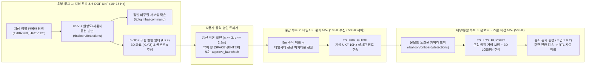
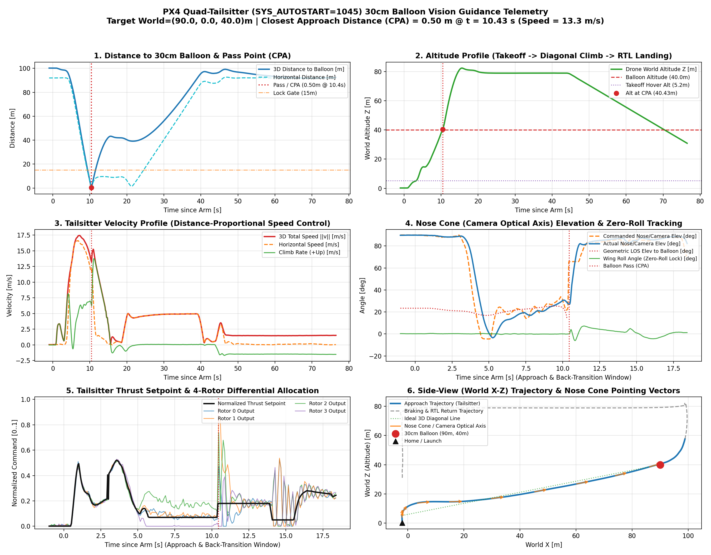
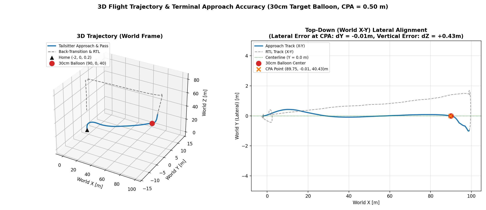

# `balloon_sim` — 지상 관측 카메라 6-DOF UKF + 쿼드 테일시터(`SYS_AUTOSTART=1045`) 다중 폐루프 유도 시뮬레이션

> **2026-11-12 `jo` 추가 / 레이싱 실험:** 승인 취소·30초 만료, 실제 송신/FC 상태 구분, 센서 신선도·짐벌 정지 재시도, 설치 경로와 테스트를 보완했습니다. [변경 내역과 검증 범위](../README.md#2026-11-12-추가--카메라-기반-레이싱-드론-실험)를 먼저 확인하세요. **3개 패키지 빌드·354개 소프트웨어 테스트 통과**이며 이번 변경에서 실기체 또는 Gazebo 비행은 실행하지 않았습니다. 아래 그래프·수치는 이전 실행 자료입니다.
>
> 실기체 뷰어의 `C`/`ESC`는 좌표 송신 승인 취소이며 비행 중단 명령이 아닙니다. `approve_launch.sh`는 시뮬레이션 전용입니다. 실기체 상태와 설정은 [HARDWARE_GUIDE.md](HARDWARE_GUIDE.md)를 기준으로 확인하세요.

지상 짐벌 카메라($1280\times960$, $12^\circ$ 망원)와 6자유도 무향 칼만 필터(**6-DOF UKF**)로 상공의 **30cm 풍선(`(90, 0, 40) m`)**을 탐색·락온하고, **사용자의 출격 승인(Trigger)** 시 2 kg 쿼드 테일시터(`stl_pacer_quad`, `1045_gazebo-classic_quadtailsitter`)가 이륙하여 지상 UKF 좌표를 실시간(10 Hz)으로 수신하며 비행하다가, 온보드 노즈콘 카메라($640\times360$, $66^\circ$) 포착 시 **3D 시선(LOS)/비례항법(PN) 종말 비전 유도**로 풍선 정중앙을 통과한 뒤 후면 전환(Back-Transition) 감속 및 RTL로 귀환·착륙하는 **다중 폐루프(Multi-Loop Closed-Loop)** 시뮬레이션 패키지입니다.

> 수학적 모델, 6-DOF UKF 수식, 테일시터 $\text{SO}(3)$ 자세·추력 분리 제어 및 3D 비례항법(PN) 유도 알고리즘 상세 설명은 **[`ALGORITHMS.md`](ALGORITHMS.md)**에 정리되어 있습니다.

---

## 1. 다중 폐루프(Closed-Loop) 동작 시퀀스



---

## 2. 주요 스크립트 및 패키지 파일 구조

| 경로 | 역할 |
| :--- | :--- |
| `tools/run_tailsitter_sim.sh` | Gazebo + PX4 쿼드 테일시터 SITL + 지상 카메라/UKF + 온보드 검출기 + 듀얼 뷰어 + 유도 제어기 통합 실행 (`run_vision_center.sh` 호환) |
| `tools/approve_launch.sh` | 지상 카메라 풍선 락온 후 터미널에서 드론 출격을 승인하는 트리거 스크립트 (카메라 창에서 `SPACE`/`ENTER` 키로도 승인 가능) |
| `tools/tailsitter_guidance.py` | 지상 UKF(10Hz) 수신 + 사용자 승인 대기 + 쿼드 테일시터 중기 경로 유도 + 온보드 3D LOS/PN 종말 유도 + 통과 판정 및 RTL 제어기 |
| `tools/restart_flight.sh` | 시뮬레이터를 끄지 않고 드론 비행만 즉시 재시작 (`refly.sh` 호환) |
| `tools/plot_tailsitter_log.py` | PX4 `.ulg` 바이너리 비행 로그를 파싱하여 6-패널 텔레메트리 대시보드 및 3D 궤적 그래프 생성 |
| `balloon_locator/balloon_locator/static_estimator.py` | 13개 Merwe 스케일 시그마 포인트 기반 **6-DOF 무향 칼만 필터(`UKFTargetEstimator`)** 및 마할라노비스 $\chi^2$ 이상치 제거 게이트 |
| `balloon_locator/balloon_locator/balloon_locator_node.py` | 지상 카메라 광학 역투영, 100Hz 노출 시각 TF 정합 및 6-DOF UKF 10Hz 상태 발행 노드 |
| `balloon_locator/balloon_locator/gazebo_bridge.py` | 지상 짐벌 상공 탐색 스윕(`STAGE 1`) → 풍선 검출 시 비주얼 서보잉 중앙 락온(`STAGE 2`) 제어 브릿지 |
| `balloon_locator/balloon_locator/detection_viewer_node.py` | 좌측 지상 짐벌 카메라 + 우측 드론 온보드 카메라 듀얼 뷰어 및 키보드(`SPACE`/`ENTER`) 출격 승인 트리거 HUD |
| `balloon_locator/balloon_locator/stl_airframe.py` | 10개 STL 조립 기체 + 4로터 차동 추력(`CA_AIRFRAME=4`) + 테일시터 주익/미익 공력(`libLiftDragPlugin.so`) SDF 생성 |
| `tools/run_hardware_gcs.sh` | **실기체 지상국(SIYI A8 mini + 6-DOF UKF + 발진 승인 뷰어 + SiK 라디오 브리지) 통합 실행 스크립트** |
| `balloon_locator/onboard/tailsitter_onboard.py` | **실기체 쿼드 테일시터 온보드(Jetson/RPi) 50Hz $\text{SO}(3)$ 자세/추력 및 3D LOS/PN 종말 유도 제어기** |
| [`ALGORITHMS.md`](ALGORITHMS.md) | **시스템에 사용된 수학적 알고리즘 및 제어·추정 수식 상세 문서** |
| [`HARDWARE_GUIDE.md`](HARDWARE_GUIDE.md) | **실기체(SIYI A8 mini + SiK 텔레메트리 + 쿼드 테일시터 온보드) 전환 및 운용 가이드** |
| [`PX4_PARAMETERS.md`](PX4_PARAMETERS.md) | **PX4 쿼드 테일시터 FC 파라미터 전체 표 및 QGC `.params` 설정 파일 안내** |

---

## 3. 시뮬레이션 실행 방법

### Step 1. 시뮬레이션 통합 기동
```bash
cd /home/seyeongw/ros2_ws/PX4-ROS2/balloon_sim
./tools/run_tailsitter_sim.sh
```
- 실행하면 Gazebo와 함께 **듀얼 카메라 뷰어 창(`onboard`)**이 열립니다.
  - **좌측 화면**: 지상 짐벌 관측 카메라 ($12^\circ$ 망원, 6-DOF UKF 상태 표시)
  - **우측 화면**: 드론 온보드 노즈콘 카메라 ($66^\circ$ 광각, 종말 LOS 추적 표시)
- 초기에는 지상 짐벌 카메라가 풍선이 없는 좌측 하단(`yaw = -20.6°`, `elev = +8.0°`)을 바라보다가, 상공을 대각선으로 스캔(`STAGE 1: SKY SEARCH`)하며 30cm 풍선을 탐색합니다.

### Step 2. 풍선 락온 확인 및 드론 출격 승인 (Trigger)
- 지상 카메라가 풍선을 발견하면 색상·원형도·채움비를 검증(`BALLOON VERIFIED`)한 뒤 십자선 중앙에 락온(`STAGE 2: BALLOON LOCKED`)하고 10 Hz로 3D 월드 좌표 `(X, Y, Z)`를 수렴시킵니다.
- 좌측 화면에서 풍선 락온 및 추정 좌표를 확인한 뒤, **아래 두 방법 중 하나**로 출격을 승인합니다:
  1. **뷰어 창 키보드 입력 (권장)**: 카메라 뷰어 창(`onboard`)을 마우스로 클릭하고 키보드 **`SPACE` (스페이스바)** 또는 **`ENTER`** (또는 `y`) 키 입력
  2. **터미널 명령어 입력**: 새 터미널에서 아래 스크립트 실행
     ```bash
     cd /home/seyeongw/ros2_ws/PX4-ROS2/balloon_sim
     ./tools/approve_launch.sh
     ```

### Step 3. 다중 폐루프 비행 · 풍선 통과 · RTL 착륙 및 로그 그래프 생성
- 승인 즉시 드론이 5m 수직 이륙 후 테일시터 자세로 전환하여 지상 UKF 좌표(`10 Hz` 실시간 수신)를 향해 상승 비행(`TS_UKF_GUIDE`)합니다.
- 비행 중 온보드 노즈콘 카메라에 풍선이 포착되면 즉시 **온보드 3D LOS/PN 종말 유도(`TS_LOS_PURSUIT`)**로 전환하여 풍선 중심을 통과하고, 후면 전환 감속 후 홈으로 자동 착륙(RTL)합니다.
- 비행 후 아래 명령어로 최신 PX4 ULog(`.ulg`) 분석 그래프를 생성할 수 있습니다:
  ```bash
  ./tools/plot_tailsitter_log.py
  ```

---

## 4. 알고리즘 요약

각 단계에 적용된 수학적 알고리즘의 핵심 요약이며, 전체 수식 유도 과정은 **[`ALGORITHMS.md`](ALGORITHMS.md)**에서 확인할 수 있습니다.

1. **풍선 비전 검출 및 형상 검증**: HSV 색공간 마스킹 → 모폴로지 연산 → 윤곽선 타원 피팅(`cv2.fitEllipse`) → 원형도($4\pi A / P^2 \ge 0.6$) 및 최소 외접원 채움비($\ge 0.55$) 검증.
2. **지상 짐벌 비주얼 서보잉 & 6-DOF UKF**: 핀홀 광학 모델($R = f \cdot D / d_{\text{px}}$)과 노출 시각 100Hz TF 변환으로 3D 관측점을 구하고, 6차원 상태 $\mathbf{x} = [p_N, p_E, p_D, v_N, v_E, v_D]^T$ 및 13개 Merwe 스케일 시그마 포인트 무향 변환(Unscented Transform)으로 위치와 공분산($s = \sqrt{\lambda_{\max}(\mathbf{P})}$)을 10 Hz로 추정.
3. **쿼드 테일시터 $\text{SO}(3)$ 자세·추력 분리 제어**: 주익/미익 공력(`libLiftDragPlugin.so`)을 활용하며, 노즈콘 광축($-\mathbf{z}_{\text{FRD}}$)을 목표 지향 벡터에 일치시키면서 우측 날개($+\mathbf{y}_{\text{FRD}}$)를 수평면에 구속하는 직교 회전행렬 $\mathbf{R}_{bn} \in \text{SO}(3)$를 구성하여 카메라 롤 회전($\text{Roll} = 0^\circ$)을 원천 차단.
4. **온보드 3D LOS/PN 종말 비전 유도**: 노즈콘 카메라 픽셀 $(u, v)$로부터 3D 시선 단위벡터 $\mathbf{u}_{\text{LOS}}$와 근접 광학 거리 $R_{\text{opt}}$를 실시간 산출하고, 시선 수직 속도 성분을 감쇄하는 3D 비례항법($\mathbf{a}_{\perp,\text{cmd}} = -N_{\text{PN}}\mathbf{v}_{\perp,\text{LOS}}$)으로 풍선 중심 통과.

---

## 5. 다중 폐루프 비행 텔레메트리 및 3D 궤적 분석 결과 (`CPA = 0.50 m`, 좌우 오차 `dY = -0.01 m`)

### 6-패널 텔레메트리 대시보드


### 3D 비행 궤적 및 평면(X-Y) 정렬 정확도

